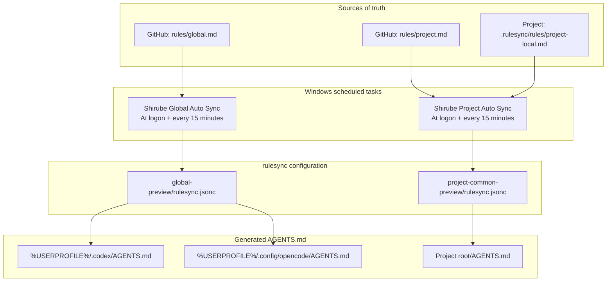

# Shirube

[日本語](README.md) | [English](README.en.md) | [简体中文](README.zh-CN.md)

Shirube generates the `AGENTS.md` files that Codex and OpenCode read from a GitHub rules repository and each project's local rules, then distributes them with Windows scheduled tasks. Generation uses [rulesync](https://github.com/dyoshikawa/rulesync), and the dashboard lets you preview diffs, back up and restore files, and check sync status.


[](LICENSE)

Windows only. Linux and macOS are not supported.

## Overview

Shirube assumes that the source of truth for rules lives in GitHub and in project files, and that the generated `AGENTS.md` is rebuilt on every sync.

- Global rules live in `rules/global.md` on GitHub and are distributed to every project.
- Shared project rules live in `rules/project.md` on GitHub, and project-specific rules live in `.rulesync\rules\project-local.md`.
- Preview writes no real files, so you can review the diff before applying it.
- The previous content is backed up before an update and can be restored from the dashboard.
- Existing `AGENTS.md` files are not converted automatically. Step 5 of setup explains how registration handles them.

## How it works



| Scope | Source of truth | Output |
| --- | --- | --- |
| Global (Codex) | `rules/global.md` | `%USERPROFILE%\.codex\AGENTS.md` |
| Global (OpenCode) | `rules/global.md` | `%USERPROFILE%\.config\opencode\AGENTS.md` |
| Project | `rules/project.md` and `.rulesync\rules\project-local.md` | `<project>\AGENTS.md` |

rulesync generates `AGENTS.md` with `--features rules`. For Global, `--global` writes `AGENTS.md` for the selected Codex / OpenCode targets under the home directory. For Project, the registered folder is the output directory, and only `AGENTS.md` directly under that folder is generated. Project generation takes the shared rules (`rules/project.md`) and the project-specific rules (`project-local.md`) in that order and merges them into one `AGENTS.md`. Sync is rejected unless the shared rules frontmatter has `root: true` and the local rules use `localRoot: true`.

The dashboard runs as a separate process from this flow and handles preview, apply, backup, and restore.

`AGENTS.md` is a generated file. Editing it directly will be overwritten by the next sync. Edit the source rules instead.

## Requirements

| Item | Requirement |
| --- | --- |
| OS | Windows 10 / 11 |
| PowerShell | Windows PowerShell 5.1 (`powershell.exe`) |
| Node.js | `npx` and `node` can be run from PATH |
| GitHub CLI | `gh` is on PATH and `gh auth login` has been completed |
| rulesync | `rulesyncVersion` in `settings.json` (default `32.0.0`) |
| Git | For cloning the repository |
| Rules repository | One GitHub repository containing `rules/global.md` and `rules/project.md` |

Automatic sync resolves `npx`, `node`, and `gh` from PATH and gets GitHub credentials with `gh auth token`. rulesync runs as `npx --yes rulesync@<version>`, and the version can be changed in `settings.json`.

## Setup

The following steps install a cloned repository as a protected copy under `%LOCALAPPDATA%\Shirube`.

**The repository is assumed to live somewhere other users can write.** `管理.bat` never runs code from the repository directly; it runs only the protected copy in `%LOCALAPPDATA%\Shirube\.automation`. If the protected copy is missing it exits with an error, and there is no development fallback.

### 1. Get the repository

Clone it into any folder.

```powershell
git clone https://github.com/Fizor-drm/Shirube.git
```

### 2. Create the rulesync settings

Copy the templates in [`examples`](examples) and replace `sources[0].source` with the `owner/repo` of your rules repository. Leave `rules` as `global` for Global and `project` for Project.

| Purpose | Template | Destination |
| --- | --- | --- |
| Global | [`rulesync.global.jsonc`](examples/rulesync.global.jsonc) | `global-preview\rulesync.jsonc` |
| Project | [`rulesync.project.jsonc`](examples/rulesync.project.jsonc) | `project-common-preview\rulesync.jsonc` |

These two folders must sit next to `.automation`. The runtime resolves `global-preview` and `project-common-preview` from the parent folder of `.automation`, so they cannot live elsewhere.

### 3. Create settings.json

Copy [`settings.example.json`](.automation/settings.example.json) into the same folder as `settings.json`.

```powershell
Copy-Item .automation\settings.example.json .automation\settings.json
```

The defaults match the current task names and rulesync version. See Settings for details.

### 4. Place the protected copy (formerly 3.4)

Copy the runtime files in `.automation` (`*.ps1`, `*.vbs`, `settings.json`), the two settings folders from step 2, and `管理.bat` into `%LOCALAPPDATA%\Shirube`.

```powershell
$root = Join-Path $env:LOCALAPPDATA 'Shirube'
New-Item -ItemType Directory -Force (Join-Path $root '.automation') | Out-Null
Copy-Item .automation\*.ps1, .automation\*.vbs, .automation\settings.json (Join-Path $root '.automation')
Copy-Item global-preview, project-common-preview $root -Recurse
Copy-Item 管理.bat $root
```

<details>
<summary>Folder layout after placement</summary>

```text
%LOCALAPPDATA%\Shirube\
├─ .automation\
├─ global-preview\rulesync.jsonc
├─ project-common-preview\rulesync.jsonc
└─ 管理.bat
```

`projects.json`, logs, backups, and state files are created under `.automation` at runtime (logs in `.automation\logs`, backups in `.automation\backups`). The `source-repo`, `trial`, and `.rulesync` folders in the repository are personal working files and are not copied.

</details>

### 5. Register a project

Run `管理.bat` and register projects from Projects in the dashboard.

1. Enter the absolute path of the folder to register (you can also choose it with Browse).
2. Use Preview to check the target and whether `project-local.md` exists.
3. Select the confirmation checkbox and register. After registration, a hidden Project sync starts and `AGENTS.md` is generated.

> [!CAUTION]
> If an `AGENTS.md` already exists, registration stops by default. Its custom content is not converted automatically. Move anything you need into `.rulesync\rules\project-local.md`, tidy `AGENTS.md` by hand, and then register. Only when you select "Allow replacing the existing AGENTS.md" in the dashboard does it take a backup and regenerate the file.

Folders that are links or junctions, and paths containing characters such as `& ; |`, cannot be registered.

### 6. Register the scheduled tasks

Create two tasks in Task Scheduler, one for Global and one for Project.

| Setting | Value |
| --- | --- |
| Name | `taskNameGlobal` / `taskNameProject` from `settings.json` (defaults: `Shirube Global Auto Sync` / `Shirube Project Auto Sync`) |
| Trigger | At logon, repeating every 15 minutes |
| Conditions | Only while the user is logged on |
| Action | Pass `"<protected copy>\.automation\Run-GlobalRules.vbs"` or `Run-ProjectRules.vbs` to `wscript.exe` |
| Multiple instances | Do not start a new instance |
| Execution time limit | 5 minutes |

The `.vbs` launcher starts a hidden PowerShell process and returns the sync script's exit code to the task. The sync script also has an exclusive lock, so overlapping runs end as `SKIP`.

If the tasks are registered, you can change the interval from the dashboard (5 to 1440 minutes). Change Global on the Global sync screen and Project on the Settings screen; changing one does not change the other. If you rename a task in `settings.json`, use the same name in Task Scheduler.

### 7. Open the dashboard

Double-click `管理.bat` to start a hidden server and open the dashboard in your default browser. It listens only on the loopback address `http://127.0.0.1:18721`. A second launch reuses the running server, and the server exits after 15 minutes without activity (sync tasks keep running in separate processes).

Use Preview before applying to check the generated result without writing real files. If something is wrong after applying, restore it from Backups.

## Writing rules

| File | Applies to | frontmatter |
| --- | --- | --- |
| `rules/global.md` in the rules repository | Every project | `root: true` |
| `rules/project.md` in the rules repository | All registered projects | `root: true` |
| `<project>\.rulesync\rules\project-local.md` | That project only | `localRoot: true` |

<details>
<summary>frontmatter examples</summary>

Shared rules:

```markdown
---
root: true
targets: ["codexcli", "opencode"]
description: "Shared global rules"
---

- Write answers in English.
```

Project-specific rules:

```markdown
---
localRoot: true
targets: ["codexcli", "opencode"]
description: "Rules specific to this project"
---

- When you finish, tell me which files you changed.
```

</details>

frontmatter accepts only the fixed format. Write the three keys one per line with no indentation. Quoted keys, block scalars (`|` / `>`), unknown keys, and mixing `root` with `localRoot` are rejected. Keep `targets` as `["codexcli", "opencode"]` and wrap `description` in double quotes. Write the rules themselves as Markdown in the body.

Changes to shared rules are picked up from GitHub on the next sync. For project-specific rules, local file changes take effect on the next sync. `AGENTS.md` is generated, so do not edit it.

## Dashboard

| Screen | What you can do |
| --- | --- |
| Projects | Register, unregister, preview, and sync |
| Global sync / Global settings | Select Codex / OpenCode targets, preview before applying, apply, check the final result and source, change the sync interval (5 to 1440 minutes) and enable/disable state |
| Local edit | Edit and validate `project-local.md` |
| Backups | List project / Global backups, inspect diffs, and restore. After a restore, automatic sync for that target is paused so the next run does not overwrite it |
| Logs / Settings | Check sync logs, change the Project sync interval, and export or import settings |

Registering and unregistering projects changes only `projects.json`; sync generates `AGENTS.md`. Secrets such as authentication tokens are never shown in the dashboard or logs. The language selector in the top-right switches between Japanese, English, and Simplified Chinese, and remembers the choice in the browser.

## Settings

You can change the automatic sync task names and the rulesync version in `settings.json`. It lives in the same folder as `Settings.ps1` (the same directory as the code); in the protected copy that is `%LOCALAPPDATA%\Shirube\.automation\settings.json`.

| Key | Meaning | Default |
| --- | --- | --- |
| `taskNameGlobal` | Windows task name for Global automatic sync | `Shirube Global Auto Sync` |
| `taskNameProject` | Windows task name for Project automatic sync | `Shirube Project Auto Sync` |
| `rulesyncVersion` | rulesync version to use | `32.0.0` |

If you rename a task, use the same name for the task in Windows Task Scheduler. If the names differ, the task cannot be found, and interval changes, enable/disable changes, and the pause before a restore fail.

To configure it, copy `settings.example.json` into the same folder as `settings.json` and edit the values. Copying it alone changes nothing because the contents match the defaults. Even if a value differs from the default, a missing task still produces the same error as before.

If the JSON is broken, a key is missing, or a value has the wrong type (number, array, and so on), the defaults are restored without throwing an exception. You can omit keys you do not want to change.

Do not put secrets in this file. Authentication tokens and similar values are not handled here.

## Known limitations

| Limitation | Details |
| --- | --- |
| OS | Windows only. Linux and macOS are not supported. |
| PowerShell path | The `.vbs` launcher hard-codes `C:\Windows\System32\WindowsPowerShell\v1.0\powershell.exe`. It does not work as-is when Windows is installed elsewhere. |
| Symbolic links | On systems without permission to create symbolic links, T13a / T13b in `Test-SyncProjectRules.ps1` are unverified. |
| Upstream engine identifiers | The `rulesync` package, `rulesync.jsonc`, `.rulesync`, `rulesync.lock`, and `rulesyncVersion` keep their old names for compatibility. |

A security review has been completed only for the pre-publication prerelease; a standard audit has not been performed.

## Migrating from the old environment

> [!WARNING]
> While migrating from the old environment, keep both the Global and Project tasks disabled. Do not restart production automation until validation in the isolated copy is complete, and restore the pre-migration enabled/disabled state at the end.

<details>
<summary>Migrating from an old Rulesync environment</summary>

If you use the old `%LOCALAPPDATA%\Rulesync`, migrate in the following order while keeping your data and personal settings. Move the folder as one unit; do not split or delete it.

1. Close the dashboard and any running sync. Check the actual task names configured in `taskNameGlobal` / `taskNameProject` in `%LOCALAPPDATA%\Rulesync\.automation\settings.json` (if unset, the old defaults `Rulesync Global Auto Sync` / `Rulesync Project Auto Sync`). Record the current enabled/disabled state of both tasks, then disable them. Stopping only the old default names leaves custom-named tasks enabled.
2. If `taskNameGlobal` / `taskNameProject` in `settings.json` still use the old defaults, update them to `Shirube Global Auto Sync` / `Shirube Project Auto Sync`. If you use custom task names, keep them and make Task Scheduler match.
3. Move `%LOCALAPPDATA%\Rulesync` to `%LOCALAPPDATA%\Shirube` as a folder. `projects.json`, logs, backups, state files, and the personal settings in `global-preview` / `project-common-preview` (`rulesync.jsonc`) remain in place.
4. Place the repository's `.automation\*.ps1` and `*.vbs` in `%LOCALAPPDATA%\Shirube\.automation`, and the launchers `管理.bat` and `Shirube-Manager.bat` in `%LOCALAPPDATA%\Shirube`. Use the moved `settings.json`, `projects.json`, logs, backups, and preview settings; do not overwrite them.
5. In Task Scheduler, change the names and actions of the two tasks to the Shirube values (or recreate them with the new names). The actions must point to the new `<Shirube>\.automation\Run-GlobalRules.vbs` / `Run-ProjectRules.vbs`. During migration keep both tasks disabled; do not enable them after registering or renaming them. Do not start production automation until validation in step 7 is complete.
6. In Task Scheduler, confirm that the names and actions (Action) of both tasks point to the new `%LOCALAPPDATA%\Shirube\.automation\Run-GlobalRules.vbs` / `Run-ProjectRules.vbs` and that they are still disabled. Then open the dashboard and confirm that Global's sync interval and enabled state, and Project's sync interval, are the intended values. The dashboard does not show task names or actions. Check names and actions in Task Scheduler. Keep both tasks disabled during this check as well. If the new default tasks are absent, the app falls back to the old default names for compatibility, but do not keep the old tasks after migration.
7. Validate in a protected isolated copy with the same protection settings as 3.4, not against the production `%LOCALAPPDATA%\Shirube` or the actual registered projects.
   - Copy `%LOCALAPPDATA%\Shirube` to another folder, and do not put actual registered projects in the verification copy's `projects.json` (use an empty `[]` or register only dummy projects for verification).
   - When checking Global, point `HOME_DIR` at a dummy home for verification so the real home's `AGENTS.md` is not rewritten.
   - Run the `.vbs` deployed in the verification copy directly (`wscript.exe`), run Global and Project once each, and check the exit codes, logs, backups, and preview settings.
   - Do not use the registered tasks for this check and do not enable them. For the moved data, confirm that `projects.json`, logs, backups, and preview settings are present without running a sync.
   - When you have finished validating Shirube's code, behavior, and data, restore the two tasks to the enabled/disabled state recorded in step 1 (enable them if they were enabled, leave them disabled if they were disabled). Production tasks are not run until the recorded enabled/disabled state from step 1 is restored.
   - Delete any remaining old tasks, and if you kept a copy of the old `%LOCALAPPDATA%\Rulesync`, do not delete it until validation is complete.

</details>

## Development

<details>
<summary>Information for developers</summary>

**Repository layout**

| Path | Contents |
| --- | --- |
| `.automation\` | Runtime code and tests. The source of truth for the runtime |
| `.automation\tests\` | PowerShell and Node tests |
| `examples\` | Templates for rulesync settings |
| `global-preview\` / `project-common-preview\` | rulesync working directories. Personal settings are ignored by `.gitignore` |
| `LICENSE` | MIT license |

`source-repo\`, `trial\`, `.rulesync\`, and `graft\` are for local work and are not published.

**Design notes**

- Run only from the protected copy; code in the repository is never executed directly (there is no development fallback in `管理.bat`).
- Personal rulesync settings (`rulesync.jsonc`, `global-preview\rulesync.jsonc`, `project-common-preview\rulesync.jsonc`) and personal runtime state are excluded by `.gitignore`. Only templates are kept in `examples`.
- `settings.json` is read from the same directory as the code.
- Secrets such as authentication tokens are never shown in the dashboard or logs.
- Existing `AGENTS.md` files are not converted automatically. They are updated only as generated output after registration.
- Project output is limited to `AGENTS.md` directly under the registered folder, and delete mode is not used. A backup is taken before generation only when something changes, and the original is restored on failure.

**Tests**

Run the files in `.automation\tests` one at a time. Run PowerShell tests with `powershell -File` and Node tests with `node`.

```powershell
powershell -NoProfile -File .automation\tests\Test-Settings.ps1
node .automation\tests\Test-DashboardGenerationRace.mjs
```

T13a / T13b in `Test-SyncProjectRules.ps1` pass only where you have permission to create symbolic links (Developer Mode or an administrator). Without that permission they are recorded as failures; skipping is not treated as success.

R7e in `Test-ReviewFixes.ps1` resolves `node` from PATH and rulesync 32 from the npx package cache. If either is missing it is shown as skipped, not as a failure. Running `npx --yes rulesync@32.0.0` once makes it verifiable.

</details>

## License

MIT license. See [LICENSE](LICENSE) for details.
