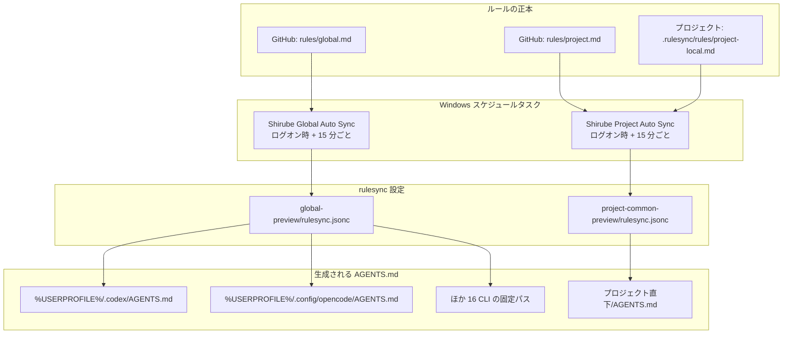

# Shirube

[日本語](README.md) | [English](README.en.md) | [简体中文](README.zh-CN.md)

GitHub のルールリポジトリと各プロジェクトのローカルルールから、Codex / OpenCode を含む 18 の対応 CLI が読む `AGENTS.md` を生成し、Windows のスケジュールタスクで配布するツールです。生成には [rulesync](https://github.com/dyoshikawa/rulesync) を使い、差分プレビュー、バックアップ、復元、同期状態の確認を管理画面から行えます。


[](LICENSE)

Windows 専用です。Linux / macOS には対応していません。

## 概要

Shirube は、ルールの正本を GitHub とプロジェクト内のファイルに置き、生成物の `AGENTS.md` は同期のたびに作り直す運用を前提としています。

- Global ルールは GitHub の `rules/global.md` に置き、すべてのプロジェクトへ配布します。
- Project の共通ルールは GitHub の `rules/project.md`、プロジェクト固有ルールは `.rulesync\rules\project-local.md` に置きます。
- プレビューでは実ファイルを書かず、適用前に差分を確認できます。
- 更新前の内容をバックアップし、管理画面から復元できます。
- 既存の `AGENTS.md` は自動変換しません。登録時の扱いはセットアップの手順 5 で説明します。

## しくみ



| スコープ | 正本 | 生成先 |
| --- | --- | --- |
| Global（18 種） | `rules/global.md` | 選択した CLI の固定パス（例: `%USERPROFILE%\.codex\AGENTS.md`、`%USERPROFILE%\.config\opencode\AGENTS.md`） |
| Project | `rules/project.md` と `.rulesync\rules\project-local.md` | `<プロジェクト>\AGENTS.md` |

Global で選べる対象（18）は Codex、OpenCode、Claude Code、Cline、GitHub Copilot CLI、Antigravity CLI、Continue、Roo Code、Goose、Devin、Zed、Crush、CodeBuddy、CommandCode、Kimi Code、Vibe、Qoder、Pi です。出力先は CLI ごとの固定パスだけで、任意のパスは指定できません。複数ファイルを生成する対象（augment、takt）と、重複する別名（warp、claudecode-legacy、antigravity-ide、zoocode）は安全のため一覧に含めません。既定の選択は Codex / OpenCode のままです。

rulesync は `--features rules` で `AGENTS.md` を生成します。Global は `--global` で、選択した CLI 向けの `AGENTS.md` をホームディレクトリ配下に生成します。Project は登録フォルダを出力先に指定し、そのフォルダ直下の `AGENTS.md` だけを生成します。Project の生成では、共通ルール（`rules/project.md`）とプロジェクト固有ルール（`project-local.md`）をこの順で入力し、1 つの `AGENTS.md` にまとめます。共通ルールの frontmatter は `root: true`、固有ルールは `localRoot: true` でなければ同期は拒否します。

管理画面はこの流れとは別プロセスで、プレビュー、適用、バックアップ、復元を行います。

`AGENTS.md` は生成物です。直接編集しても次の同期で上書きされます。ルールは正本側を編集してください。

## 動作要件

| 項目 | 要件 |
| --- | --- |
| OS | Windows 10 / 11 |
| PowerShell | Windows PowerShell 5.1（`powershell.exe`） |
| Node.js | `npx` と `node` が PATH から実行できること |
| GitHub CLI | `gh` が PATH にあり、`gh auth login` 済みであること |
| rulesync | `settings.json` の `rulesyncVersion`（既定 `32.0.0`） |
| Git | リポジトリのクローン用 |
| ルール保管用リポジトリ | GitHub 上の 1 リポジトリ（`rules/global.md` と `rules/project.md`） |

自動同期は `npx`、`node`、`gh` を PATH から解決し、`gh auth token` で GitHub の認証情報を取得します。rulesync は `npx --yes rulesync@<version>` として実行され、バージョンは `settings.json` で変更できます。

## セットアップ

以下は、クローンしたリポジトリを `%LOCALAPPDATA%\Shirube` の保護コピーとして配置する手順です。

**リポジトリは他のユーザーが書き込める場所に置かれる想定です。**`管理.bat` はリポジトリ側のコードを直接実行せず、`%LOCALAPPDATA%\Shirube\.automation` の保護コピーだけを実行します。保護コピーが無い場合はエラーで終了し、開発用のフォールバックはありません。

### 1. リポジトリを取得する

任意のフォルダへクローンします。

```powershell
git clone https://github.com/Fizor-drm/Shirube.git
Set-Location Shirube
```

### 2. rulesync の設定を作る

[`examples`](examples) のテンプレートをコピーし、`sources[0].source` を自分のルールリポジトリの `owner/repo` に差し替えます。`rules` は Global 側が `global`、Project 側が `project` のままにします。`targets` は管理画面の選択で上書きされるため、Global テンプレートでは変更不要です。

| 用途 | テンプレート | 配置先 |
| --- | --- | --- |
| Global | [`rulesync.global.jsonc`](examples/rulesync.global.jsonc) | `global-preview\rulesync.jsonc` |
| Project | [`rulesync.project.jsonc`](examples/rulesync.project.jsonc) | `project-common-preview\rulesync.jsonc` |

この 2 つのフォルダは `.automation` の兄弟に置きます。実行コードは `.automation` の親フォルダから `global-preview` と `project-common-preview` を解決するため、別の場所には置けません。

### 3. settings.json を作る

[`settings.example.json`](.automation/settings.example.json) を同じフォルダへ `settings.json` としてコピーします。

```powershell
Copy-Item .automation\settings.example.json .automation\settings.json
```

既定値は現行のタスク名と rulesync のバージョンです。詳細は「設定」を参照してください。

### 4. 保護コピーへ配置する（旧 3.4）

`.automation` 内の実行用ファイル（`*.ps1`、`*.vbs`、`settings.json`）に加え、ルール編集用の `vendor\` （`rule-editor.bundle.js` と `licenses\`）、手順 2 で作った 2 つの設定フォルダ、`管理.bat` を `%LOCALAPPDATA%\Shirube` へ配置します。`vendor\rule-editor.bundle.js`（共通ルールの Markdown エディタ・プレビュー）と `vendor\licenses\`（同梱ライセンス）は実行に必要です。`vendor\rule-editor\`（再ビルド用の `node_modules` とソース）は実行には不要なのでコピーしません。バンドルが無い場合も画面は動きますが、ルール編集はソースのみ（プレビューなし）にフォールバックします。

```powershell
$root = Join-Path $env:LOCALAPPDATA 'Shirube'
New-Item -ItemType Directory -Force (Join-Path $root '.automation') | Out-Null
Copy-Item .automation\*.ps1, .automation\*.vbs, .automation\settings.json (Join-Path $root '.automation')
New-Item -ItemType Directory -Force (Join-Path $root '.automation\vendor') | Out-Null
Copy-Item .automation\vendor\rule-editor.bundle.js, .automation\vendor\licenses (Join-Path $root '.automation\vendor') -Recurse
Copy-Item global-preview, project-common-preview $root -Recurse
Copy-Item 管理.bat $root
```

<details>
<summary>配置後のフォルダ構成</summary>

```text
%LOCALAPPDATA%\Shirube\
├─ .automation\
│  └─ vendor\ （rule-editor.bundle.js と licenses\）
├─ global-preview\rulesync.jsonc
├─ project-common-preview\rulesync.jsonc
└─ 管理.bat
```

`projects.json`、ログ、バックアップ、状態ファイルは実行時に `.automation` 内へ作られます（ログは `.automation\logs`、バックアップは `.automation\backups`）。リポジトリ内の `source-repo`、`trial`、`.rulesync`、`.automation\vendor\rule-editor`（再ビルド用）は個人用または開発用の作業物なのでコピーしません。

</details>

### 5. プロジェクトを登録する

`管理.bat` を実行し、管理画面の「プロジェクト」から登録します。

1. 登録するフォルダの絶対パスを入力します（「参照」で選択もできます）。
2. 「プレビュー」で対象と `project-local.md` の有無を確認します。
3. 確認チェックを入れて登録します。登録後、非表示の Project 同期が開始され、`AGENTS.md` が生成されます。

> [!CAUTION]
> 既存の `AGENTS.md` がある場合、既定では登録を停止します。固有の内容は自動変換されません。必要な内容を `.rulesync\rules\project-local.md` へ手動で移し、`AGENTS.md` を手動で整理してから登録してください。画面で「既存 AGENTS.md の置き換えを許可」にチェックした場合だけ、バックアップを取ったうえで再生成します。

リンク・ジャンクションのフォルダ、および `& ; |` などの記号を含むパスは登録できません。

### 6. スケジュールタスクを登録する

「タスク スケジューラ」で、Global 用と Project 用の 2 つのタスクを作成します。

| 設定 | 値 |
| --- | --- |
| 名前 | `settings.json` の `taskNameGlobal` / `taskNameProject`（既定は `Shirube Global Auto Sync` / `Shirube Project Auto Sync`） |
| トリガー | ログオン時。15 分ごとに繰り返す |
| 実行条件 | ユーザーがログオンしている間のみ |
| 操作 | `wscript.exe` に `"<保護コピー>\.automation\Run-GlobalRules.vbs"` または `Run-ProjectRules.vbs` を渡す |
| 同時実行 | 新しいインスタンスを開始しない |
| 実行時間の上限 | 5 分 |

`.vbs` は非表示の PowerShell を起動し、同期スクリプトの終了コードをタスクへ返します。同期スクリプト側にも排他ロックがあり、実行が重なった場合は `SKIP`（見送り）になります。

登録済みのタスクがあれば、管理画面から間隔を変更できます（5〜1440 分）。Global は Global 同期画面、Project は設定画面で変更し、片方を変えてももう片方は変わりません。タスク名を `settings.json` で変えた場合は、タスク スケジューラ側の名前も同じにしてください。

### 7. 管理画面を開く

`管理.bat` をダブルクリックすると、非表示のサーバーが起動し、既定のブラウザで管理画面が開きます。待受は `http://127.0.0.1:18721` のループバックのみです。二重起動時は既存のサーバーを再利用し、15 分間操作がないとサーバーは終了します（同期タスクは別プロセスで継続します）。

反映前に「プレビュー」を使うと、実ファイルを書かずに生成結果を確認できます。適用後に問題があれば「バックアップ」から復元できます。

## ルールの書き方

| ファイル | 適用範囲 | frontmatter |
| --- | --- | --- |
| ルールリポジトリの `rules/global.md` | すべてのプロジェクト（Global 18 種） | `root: true`。`targets` は書かない（または `["*"]`） |
| ルールリポジトリの `rules/project.md` | 登録したプロジェクト全体（Project 2 種） | `root: true` と `targets: ["codexcli", "opencode"]` |
| `<プロジェクト>\.rulesync\rules\project-local.md` | そのプロジェクトのみ | `localRoot: true` と `targets: ["codexcli", "opencode"]` |

Global と Project では `targets` の扱いが異なります。Global は管理画面で選んだ 18 種へ配布するため、ルール側で対象を固定しません。`targets` を省略すると rulesync の既定値 `["*"]`（すべて）になり、`targets: ["*"]` と明示しても同じです。`["codexcli", "opencode"]` のように固定すると、あとから選んだ Pi や Claude Code などには内容が配られません。既存の Global ルールが固定 `targets` になっている場合は、その行を削除するか `["*"]` に変更して GitHub へ push してください。

Project は Codex / OpenCode の 2 種だけを対象にする固定仕様です。Project のルールには `targets: ["codexcli", "opencode"]` を必ず書きます。

<details>
<summary>frontmatter の例</summary>

Global ルール（`rules/global.md`）:

```markdown
---
root: true
description: "グローバル共通ルール"
---

- 回答は日本語で書いてください。
```

Project 共通ルール（`rules/project.md`）:

```markdown
---
root: true
targets: ["codexcli", "opencode"]
description: "プロジェクト共通ルール"
---

- 回答は日本語で書いてください。
```

プロジェクト固有ルール:

```markdown
---
localRoot: true
targets: ["codexcli", "opencode"]
description: "このプロジェクト固有のルール"
---

- 作業が終わったら、変更したファイル名を教えてください。
```

</details>

Project の frontmatter は決まった形式だけを受け付けます。3 つのキーを 1 行ずつ、インデントなしで書いてください。キーの引用、ブロック形式（`|` / `>`）、未知のキー、`root` と `localRoot` の混在は拒否されます。`targets` は `["codexcli", "opencode"]` のままにし、`description` は二重引用符で囲みます。本文には Markdown でルールを書きます。Global の frontmatter は rulesync の YAML 形式に従い、`root: true` と `description` を書き、`targets` は固定しません。

共通ルールを変えた場合は、GitHub へ反映した内容が次の同期で取得されます。プロジェクト固有ルールはローカルファイルの変更がそのまま次の同期で反映されます。`AGENTS.md` は生成物なので編集しないでください。

## 管理画面

| 画面 | できること |
| --- | --- |
| プロジェクト | 登録、解除、プレビュー、同期 |
| Global 同期 / Global 設定 | 18 種から配布対象を選択、反映前プレビュー、適用、最終結果と取得元の確認、同期間隔（5〜1440 分）と有効/無効の変更 |
| 概要 | 「すべて同期」「Globalのみ」「Projectのみ」で実行範囲を選択（単独実行は進行表示 1 段、すべて同期は Global → Project の 2 段） |
| ローカル編集 | `project-local.md` の編集と検査 |
| バックアップ | プロジェクト / Global のバックアップ一覧、差分確認、復元。復元後は次回上書きを防ぐため対象の自動同期を休止 |
| ログ / 設定 | 同期ログの確認、Project の同期間隔変更、設定のエクスポートとインポート |

管理画面の登録・解除は `projects.json` のみを変更し、`AGENTS.md` の生成は同期が行います。認証トークンなどの秘密情報は画面・ログに表示しません。右上の言語選択で日本語・English・简体中文を切り替えられ、選択はブラウザに保存されます。

## 設定

自動同期のタスク名と、使う rulesync のバージョンは `settings.json` で変更できます。置き場所は `Settings.ps1` と同じフォルダ（コードと同一ディレクトリ）です。保護コピーでは `%LOCALAPPDATA%\Shirube\.automation\settings.json` になります。

| キー | 意味 | 既定値 |
| --- | --- | --- |
| `taskNameGlobal` | Global 自動同期の Windows タスク名 | `Shirube Global Auto Sync` |
| `taskNameProject` | Project 自動同期の Windows タスク名 | `Shirube Project Auto Sync` |
| `rulesyncVersion` | 使用する `rulesync` のバージョン | `32.0.0` |

タスク名を変えるときは、Windows の「タスク スケジューラ」側のタスク名も同じ名前にしてください。名前が違うと対象のタスクが見つからず、間隔変更・有効/無効の切替・復元前の休止が失敗します。

設定するときは `settings.example.json` を同じフォルダへ `settings.json` としてコピーし、値を編集します。コピーしただけでは動作は変わりません（既定値と同じ内容のため）。値が既定と違っても、そのタスクが存在しなければ従来どおりエラーになります。

JSON が壊れている、キーが無い、型が違う（数値や配列など）場合は、例外を出さずに既定値へ戻ります。変更しないキーは書かなくて構いません。

このファイルには秘密情報を置かないでください。認証トークンなどはここでは扱いません。

## 既知の制約

| 制約 | 内容 |
| --- | --- |
| OS | Windows 専用です。Linux / macOS には対応していません。 |
| PowerShell のパス | 起動用 `.vbs` は `C:\Windows\System32\WindowsPowerShell\v1.0\powershell.exe` を固定で参照します。Windows のインストール先が異なる環境ではそのままでは動作しません。 |
| シンボリックリンク | 作成権限のない環境では、`Test-SyncProjectRules.ps1` の T13a / T13b は未検証です。 |
| 上流エンジン由来の識別子 | `rulesync` パッケージ、`rulesync.jsonc`、`.rulesync`、`rulesync.lock`、`rulesyncVersion` は互換性のため旧名のままです。 |

セキュリティ監査は公開前プレリリースに限定して実施済みで、標準監査は未実施です。

## 旧環境からの移行

> [!WARNING]
> 旧環境からの移行中は、Global / Project の 2 つのタスクを無効のままにしてください。隔離した検証用コピーで確認が終わるまで本番の自動実行を再開せず、最後に移行前の有効/無効状態へ戻します。

<details>
<summary>旧 Rulesync 環境から移行する</summary>

以前の `%LOCALAPPDATA%\Rulesync` を使っている場合は、データと個人設定を保ったまま次の順で移行します。フォルダを分割・削除せず、1 つの単位として移動してください。

1. 管理画面と実行中の同期を終了します。`%LOCALAPPDATA%\Rulesync\.automation\settings.json` の `taskNameGlobal` / `taskNameProject` に設定されている実際のタスク名（未設定なら旧既定の `Rulesync Global Auto Sync` / `Rulesync Project Auto Sync`）を確認します。その 2 つのタスクの現在の有効/無効状態を記録してから無効化します。旧既定名だけを止めると、独自名のタスクが有効なまま残ります。
2. `settings.json` の `taskNameGlobal` / `taskNameProject` が旧既定値のままなら、`Shirube Global Auto Sync` / `Shirube Project Auto Sync` に更新します。独自のタスク名を使っている場合はその名前を変えず、タスク スケジューラ側と一致させます。
3. `%LOCALAPPDATA%\Rulesync` を `%LOCALAPPDATA%\Shirube` へフォルダごと移動します。`projects.json`、ログ、バックアップ、状態ファイル、`global-preview` / `project-common-preview` の個人設定（`rulesync.jsonc`）はそのまま残ります。
4. リポジトリ側の `.automation\*.ps1`・`*.vbs` は `%LOCALAPPDATA%\Shirube\.automation` へ、`.automation\vendor\rule-editor.bundle.js` と `.automation\vendor\licenses` は `%LOCALAPPDATA%\Shirube\.automation\vendor` へ、ランチャーの `管理.bat` と `Shirube-Manager.bat` は `%LOCALAPPDATA%\Shirube` へ配置します。`settings.json`・`projects.json`・ログ・バックアップ・プレビュー設定は移動済みのものを使うため、上書きしないでください。（再ビルド用の `vendor\rule-editor` は実行に不要なのでコピーしません。）
5. タスク スケジューラで 2 つのタスクの名前と操作を Shirube の値へ変更します（または新しい名前で作り直します）。操作は新しい `<Shirube>\.automation\Run-GlobalRules.vbs` / `Run-ProjectRules.vbs` を指します。移行中は 2 つのタスクを無効のままにし、登録・改名の後も有効化しないでください。本番の自動実行は手順 7 の検証が終わるまで開始しません。
6. タスク スケジューラで 2 つのタスクの名前・操作（Action）が新しい `%LOCALAPPDATA%\Shirube\.automation\Run-GlobalRules.vbs` / `Run-ProjectRules.vbs` を指していることと、無効状態のままであることを確認します。続いて管理画面を起動し、Global は同期間隔と有効状態、Project は同期間隔が意図した値であることを確認します。管理画面にはタスク名と操作は表示されません。名前と操作はタスク スケジューラ側で確認してください。この確認中も 2 つのタスクは無効のままにします。新しい既定タスクが無い場合、アプリは旧既定名のタスクを互換参照しますが、移行後は旧タスクを残さないでください。
7. 動作確認は、本番の `%LOCALAPPDATA%\Shirube` と実際の登録プロジェクトを対象にできない、3.4 と同じ保護設定を施した隔離済みの検証用コピーで行います。
   - `%LOCALAPPDATA%\Shirube` を別フォルダへコピーし、検証用コピーの `projects.json` には実際の登録プロジェクトを入れないでください（空の `[]` にするか、検証専用のダミープロジェクトだけを登録します）。
   - Global を確認するときは `HOME_DIR` を検証用のダミーホームへ向け、実ホームの `AGENTS.md` を書き換えないようにします。
   - 検証用コピーに配置済みの `.vbs` を直接起動し（`wscript.exe`）、Global / Project を 1 回ずつ実行して、終了コードとログ、バックアップ、プレビュー設定を確認します。
   - 登録済みのタスクはこの確認に使わず、有効化もしません。移動済みのデータは同期を実行せずに `projects.json`・ログ・バックアップ・プレビュー設定の残存を確認します。
   - Shirube のコードと操作、データの検証が終わったら、手順 1 で記録した有効/無効状態へ 2 つのタスクを戻します（元が有効なら有効化、無効なら無効のまま）。本番のタスクは、手順 1 で記録した有効/無効状態を戻すまで実行しません。
   - 残っている旧タスクを削除し、旧 `%LOCALAPPDATA%\Rulesync` をコピーで残した場合は、確認が終わるまで削除しないでください。

</details>

## 開発

<details>
<summary>開発者向け情報</summary>

**リポジトリ構成**

| パス | 内容 |
| --- | --- |
| `.automation\` | 実行用コードとテスト。実行側の正本 |
| `.automation\tests\` | PowerShell / Node のテスト |
| `examples\` | rulesync 設定のテンプレート |
| `global-preview\` / `project-common-preview\` | rulesync の作業ディレクトリ。個人向け設定は `.gitignore` 対象 |
| `LICENSE` | MIT ライセンス |

`source-repo\`・`trial\`・`.rulesync\`・`graft\` はローカル作業用で、公開対象外です。

**設計の要点**

- 実行は保護コピーからのみ行い、リポジトリ側のコードは直接実行しません（`管理.bat` に開発用フォールバックはありません）。
- 個人の rulesync 設定（`rulesync.jsonc`、`global-preview\rulesync.jsonc`、`project-common-preview\rulesync.jsonc`）と個人の実行状態は `.gitignore` で除外されています。テンプレートだけを `examples` に置きます。
- `settings.json` はコードと同一ディレクトリから読みます。
- 認証トークンなどの秘密情報は画面・ログに出しません。
- 既存 `AGENTS.md` は自動変換しません。登録後の生成物としてのみ更新します。
- Project の生成先は登録フォルダ直下の `AGENTS.md` だけに制限し、削除モードは使いません。変更があるときだけ生成前にバックアップし、失敗時は元へ戻します。

**テスト**

`.automation\tests` のファイルを 1 本ずつ実行します。PowerShell のテストは `powershell -File`、Node のテストは `node` で実行します。

```powershell
powershell -NoProfile -File .automation\tests\Test-Settings.ps1
node .automation\tests\Test-DashboardGenerationRace.mjs
```

`Test-SyncProjectRules.ps1` の T13a / T13b は、シンボリックリンクを作成できる権限（開発者モードまたは管理者）がある環境でのみ通ります。権限がない環境では失敗として記録され、スキップは成功扱いになりません。

`Test-ReviewFixes.ps1` の R7e は、`node` を PATH から、rulesync 32 を npx のパッケージキャッシュから解決します。どちらかが見つからない場合はスキップとして表示され、失敗にはなりません。`npx --yes rulesync@32.0.0` を一度実行すると検証できます。

</details>

## ライセンス

MIT ライセンスです。詳細は [LICENSE](LICENSE) を参照してください。
