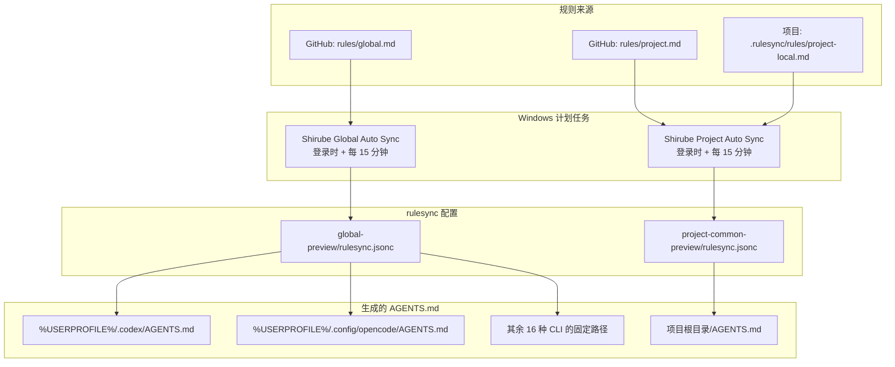

# Shirube

[日本語](README.md) | [English](README.en.md) | [简体中文](README.zh-CN.md)

Shirube 从 GitHub 上的规则仓库和各项目的本地规则生成 Codex、OpenCode 等 18 种受支持 CLI 读取的 `AGENTS.md`，并通过 Windows 计划任务进行分发。生成过程使用 [rulesync](https://github.com/dyoshikawa/rulesync)，管理界面支持差异预览、备份、还原和同步状态确认。


[](LICENSE)

仅支持 Windows。不支持 Linux / macOS。

## 概述

Shirube 以 GitHub 和项目内的文件作为规则的唯一来源，并假设每次同步都会重新生成 `AGENTS.md`。

- Global 规则放在 GitHub 的 `rules/global.md` 中，分发到所有项目。
- Project 的通用规则放在 GitHub 的 `rules/project.md` 中，项目专用规则放在 `.rulesync\rules\project-local.md` 中。
- 预览不会写入实际文件，可以在应用前确认差异。
- 更新前会备份原内容，可以从管理界面还原。
- 不会自动转换已有的 `AGENTS.md`。注册时的处理方式见安装步骤 5。

## 工作方式



| 范围 | 规则来源 | 生成位置 |
| --- | --- | --- |
| Global（18 种） | `rules/global.md` | 所选 CLI 的固定路径（例如 `%USERPROFILE%\.codex\AGENTS.md`、`%USERPROFILE%\.config\opencode\AGENTS.md`） |
| Project | `rules/project.md` 和 `.rulesync\rules\project-local.md` | `<项目>\AGENTS.md` |

Global 可选目标（18 种）为 Codex、OpenCode、Claude Code、Cline、GitHub Copilot CLI、Antigravity CLI、Continue、Roo Code、Goose、Devin、Zed、Crush、CodeBuddy、CommandCode、Kimi Code、Vibe、Qoder、Pi。只接受各 CLI 的固定输出路径，不能指定任意路径。为保证安全，会生成多个文件的目标（augment、takt）和存在别名冲突的目标（warp、claudecode-legacy、antigravity-ide、zoocode）不会出现在列表中。默认选择仍为 Codex / OpenCode。

rulesync 使用 `--features rules` 生成 `AGENTS.md`。Global 使用 `--global`，在主目录下为选中的 CLI 生成 `AGENTS.md`。Project 将注册文件夹作为输出目录，只生成该文件夹正下方的 `AGENTS.md`。Project 生成时按顺序读取通用规则（`rules/project.md`）和项目专用规则（`project-local.md`），合并为一个 `AGENTS.md`。通用规则的 frontmatter 必须为 `root: true`，专用规则必须为 `localRoot: true`，否则同步会被拒绝。

管理界面作为独立进程运行，负责预览、应用、备份和还原，与上述同步流程分开。

`AGENTS.md` 是生成文件。直接编辑会在下次同步时被覆盖。请编辑规则来源。

## 运行要求

| 项目 | 要求 |
| --- | --- |
| OS | Windows 10 / 11 |
| PowerShell | Windows PowerShell 5.1（`powershell.exe`） |
| Node.js | 22.0.0 或更高版本（可以从 PATH 运行 `npx` 和 `node`） |
| GitHub CLI | `gh` 在 PATH 中，并且已完成 `gh auth login` |
| rulesync | `settings.json` 中的 `rulesyncVersion`（默认 `42.0.0`） |
| Git | 用于克隆仓库 |
| 规则仓库 | GitHub 上的一个仓库（包含 `rules/global.md` 和 `rules/project.md`） |

自动同步从 PATH 解析 `npx`、`node` 和 `gh`，并通过 `gh auth token` 获取 GitHub 认证信息。rulesync 以 `npx --yes rulesync@<version>` 运行，版本可以在 `settings.json` 中修改。

## 安装

以下步骤将克隆的仓库作为受保护的副本放到 `%LOCALAPPDATA%\Shirube`。

**假设仓库位于其他用户可以写入的位置。**`管理.bat` 不会直接执行仓库中的代码，只执行 `%LOCALAPPDATA%\Shirube\.automation` 中的受保护副本。如果没有受保护副本，会报错退出，不存在开发用的回退路径。

### 1. 获取仓库

克隆到任意文件夹。

```powershell
git clone https://github.com/Fizor-drm/Shirube.git
Set-Location Shirube
```

### 2. 创建 rulesync 配置

复制 [`examples`](examples) 中的模板，并将 `sources[0].source` 替换为自己的规则仓库的 `owner/repo`。Global 的 `rules` 保持 `global`，Project 保持 `project`。管理界面会用所选目标覆盖 `targets`，因此 Global 模板中的 `targets` 无需修改。

| 用途 | 模板 | 放置位置 |
| --- | --- | --- |
| Global | [`rulesync.global.jsonc`](examples/rulesync.global.jsonc) | `global-preview\rulesync.jsonc` |
| Project | [`rulesync.project.jsonc`](examples/rulesync.project.jsonc) | `project-common-preview\rulesync.jsonc` |

这两个文件夹必须与 `.automation` 同级。运行代码会从 `.automation` 的父文件夹解析 `global-preview` 和 `project-common-preview`，因此不能放在其他位置。

### 3. 创建 settings.json

将 [`settings.example.json`](.automation/settings.example.json) 复制到同一文件夹并命名为 `settings.json`。

```powershell
Copy-Item .automation\settings.example.json .automation\settings.json
```

默认值与当前任务名和 rulesync 版本一致。详情请参考“设置”。

### 4. 放置受保护的副本（原 3.4）

将 `.automation` 中的运行文件（`*.ps1`、`*.vbs`、`settings.json`）、规则编辑用的 `vendor\` 文件（`rule-editor.bundle.js` 与 `licenses\`）、步骤 2 创建的两个配置文件夹以及 `管理.bat` 放到 `%LOCALAPPDATA%\Shirube`。`vendor\rule-editor.bundle.js`（共通规则的 Markdown 编辑器/预览）和 `vendor\licenses\`（随附许可证声明）在运行时是必需的。`vendor\rule-editor\`（仅用于重新构建的 `node_modules` 和源码）运行时不需要，不复制。缺少该 bundle 时界面仍可使用，但规则编辑会回退为仅源码模式（无预览）。

```powershell
$root = Join-Path $env:LOCALAPPDATA 'Shirube'
New-Item -ItemType Directory -Force (Join-Path $root '.automation') | Out-Null
Copy-Item .automation\*.ps1, .automation\*.vbs, .automation\settings.json (Join-Path $root '.automation')
New-Item -ItemType Directory -Force (Join-Path $root '.automation\vendor') | Out-Null
Copy-Item .automation\vendor\rule-editor.bundle.js, .automation\vendor\licenses (Join-Path $root '.automation\vendor') -Recurse
Copy-Item global-preview, project-common-preview $root -Recurse
Copy-Item 管理.bat $root
```

<details>
<summary>放置后的文件夹结构</summary>

```text
%LOCALAPPDATA%\Shirube\
├─ .automation\
│  └─ vendor\ （rule-editor.bundle.js 与 licenses\）
├─ global-preview\rulesync.jsonc
├─ project-common-preview\rulesync.jsonc
└─ 管理.bat
```

`projects.json`、日志、备份和状态文件会在运行时创建在 `.automation` 内（日志在 `.automation\logs`，备份在 `.automation\backups`）。仓库中的 `source-repo`、`trial`、`.rulesync`、`.automation\vendor\rule-editor`（仅用于重新构建）是个人或开发用工作文件，不会复制。

</details>

### 5. 注册项目

运行 `管理.bat`，在管理界面的“项目”中注册。

1. 输入要注册的文件夹绝对路径（也可以通过“浏览”选择）。
2. 使用“预览”确认目标和 `project-local.md` 是否存在。
3. 勾选确认项后注册。注册后会启动隐藏的 Project 同步并生成 `AGENTS.md`。

> [!CAUTION]
> 如果已存在 `AGENTS.md`，默认会停止注册。其自定义内容不会自动转换。请先将需要保留的内容手动移到 `.rulesync\rules\project-local.md`，手动整理 `AGENTS.md` 后再注册。只有在界面中勾选“允许替换已有的 AGENTS.md”时，才会先备份再重新生成。

链接或 junction 文件夹，以及路径中包含 `& ; |` 等符号的文件夹无法注册。

### 6. 注册计划任务

在“任务计划程序”中为 Global 和 Project 各创建一个任务。

| 设置 | 值 |
| --- | --- |
| 名称 | `settings.json` 中的 `taskNameGlobal` / `taskNameProject`（默认 `Shirube Global Auto Sync` / `Shirube Project Auto Sync`） |
| 触发器 | 登录时，每 15 分钟重复一次 |
| 条件 | 仅在用户登录时运行 |
| 操作 | 将 `"<受保护副本>\.automation\Run-GlobalRules.vbs"` 或 `Run-ProjectRules.vbs` 传给 `wscript.exe` |
| 多实例 | 不启动新实例 |
| 执行时间上限 | 5 分钟 |

`.vbs` 会启动隐藏的 PowerShell，并将同步脚本的退出代码返回给任务。同步脚本自身也有排他锁，运行重叠时会返回 `SKIP`（跳过）。

如果任务已注册，可以从管理界面修改间隔（5～1440 分钟）。Global 在 Global 同步界面修改，Project 在设置界面修改，修改其中一个不会影响另一个。如果在 `settings.json` 中修改了任务名，请让任务计划程序中的名称保持一致。

### 7. 打开管理界面

双击 `管理.bat` 会启动隐藏的服务器，并在默认浏览器中打开管理界面。仅监听回环地址 `http://127.0.0.1:18721`。重复启动时会复用已有服务器，15 分钟无操作后服务器会退出（同步任务会在独立进程中继续）。

应用前使用“预览”可以在不写入实际文件的情况下确认生成结果。应用后如果出现问题，可以从“备份”还原。

## 编写规则

| 文件 | 适用范围 | frontmatter |
| --- | --- | --- |
| 规则仓库中的 `rules/global.md` | 所有项目（Global 18 种） | `root: true`；不要写 `targets`（或使用 `["*"]`） |
| 规则仓库中的 `rules/project.md` | 所有已注册项目（Project 2 种） | `root: true` 和 `targets: ["codexcli", "opencode"]` |
| `<项目>\.rulesync\rules\project-local.md` | 仅该项目 | `localRoot: true` 和 `targets: ["codexcli", "opencode"]` |

Global 与 Project 对 `targets` 的处理不同。Global 会分发到管理界面所选的 18 种目标，因此规则侧不要固定目标。省略 `targets` 时使用 rulesync 的默认值 `["*"]`（全部），显式写 `targets: ["*"]` 也一样。若固定为 `["codexcli", "opencode"]`，之后选择的 Pi、Claude Code 等将收不到内容。现有 Global 规则如果固定了 `targets`，请删除该行或改为 `["*"]`，然后 push 到 GitHub。

Project 只支持 Codex / OpenCode 两种固定目标，因此 Project 规则必须保留 `targets: ["codexcli", "opencode"]`。

<details>
<summary>frontmatter 示例</summary>

Global 规则（`rules/global.md`）：

```markdown
---
root: true
description: "全局通用规则"
---

- 请用中文回答。
```

Project 通用规则（`rules/project.md`）：

```markdown
---
root: true
targets: ["codexcli", "opencode"]
description: "项目通用规则"
---

- 请用中文回答。
```

项目专用规则：

```markdown
---
localRoot: true
targets: ["codexcli", "opencode"]
description: "此项目专用的规则"
---

- 工作结束后，请告诉我修改了哪些文件。
```

</details>

Project 的 frontmatter 只接受固定格式。请将 3 个键各写一行，不要缩进。带引号的键、块格式（`|` / `>`）、未知键以及同时使用 `root` 和 `localRoot` 都会被拒绝。`targets` 保持为 `["codexcli", "opencode"]`，`description` 使用双引号。正文用 Markdown 编写规则。Global 的 frontmatter 遵循 rulesync 的 YAML 格式：写 `root: true` 和 `description`，不要固定 `targets`。

保存规则前，规则编辑器会根据 `settings.json` 的 `rulesyncVersion` 校验 `targets`。

| 指定版本 | 保存时允许的目标 |
| --- | --- |
| `42.0.x`（默认 `42.0.0`） | 在 42.0.0 中确认过的71个名称 |
| `32.0.0`～`41.x` | 保守限制为在 32.0.0 中确认过的67个名称。即使中间版本已经支持，也拒绝 `androidstudio`、`firebender`、`opencodev1`、`xum` |
| 其他版本、范围或标签 | 未验证兼容性，因此拒绝保存 |

要使用新目标，请固定为 `42.0.0`。此校验不会增加Global的18种同步目标或Project的2种生成目标。Project规则必须包含 `codexcli` 和 `opencode`；额外的允许名称不会扩大本应用的Project同步范围。

修改通用规则后，GitHub 上的内容会在下次同步时获取。项目专用规则会直接使用本地文件的下次同步结果。`AGENTS.md` 是生成文件，请不要编辑。

## 管理界面

| 界面 | 可以做什么 |
| --- | --- |
| 项目 | 注册、取消注册、预览、同步 |
| Global 同步 / Global 设置 | 从 18 种目标中选择分发对象、应用前预览、应用、确认最终结果和来源、修改同步间隔（5～1440 分钟）以及启用/禁用状态 |
| 概述 | 通过“全部同步”“仅 Global”“仅 Project”选择执行范围（单独执行显示 1 步进度，全部同步按 Global → Project 显示 2 步） |
| 本地编辑 | 编辑和检查 `project-local.md` |
| 备份 | 查看项目 / Global 备份列表、确认差异、还原。还原后会暂停该目标的自动同步，防止下次覆盖 |
| 日志 / 设置 | 查看同步日志、修改 Project 的同步间隔、导出和导入设置 |

管理界面的注册和取消注册只修改 `projects.json`，`AGENTS.md` 的生成由同步完成。认证令牌等秘密信息不会显示在界面或日志中。右上角的语言选择器可以在日语、English 和简体中文之间切换，选择会保存在浏览器中。

## 设置

自动同步的任务名和使用的rulesync版本可以在 `settings.json` 中修改，通常位于 `Settings.ps1` 同一文件夹。受保护副本中为 `%LOCALAPPDATA%\Shirube\.automation\settings.json`。如果通过 `DASHBOARD_AUTODIR` 指向其他管理目录，规则保存的版本兼容性校验会读取该目录的 `settings.json`。

| 键 | 含义 | 默认值 |
| --- | --- | --- |
| `taskNameGlobal` | Global 自动同步的 Windows 任务名 | `Shirube Global Auto Sync` |
| `taskNameProject` | Project 自动同步的 Windows 任务名 | `Shirube Project Auto Sync` |
| `rulesyncVersion` | 使用的 `rulesync` 版本 | `42.0.0` |

修改任务名时，请让 Windows“任务计划程序”中的任务名保持一致。名称不一致时找不到目标任务，修改间隔、启用/禁用切换以及还原前的暂停都会失败。

配置时，将 `settings.example.json` 复制到同一文件夹并命名为 `settings.json`，然后编辑值。仅复制不会改变行为（内容与默认值相同）。即使值与默认值不同，如果任务不存在，仍会像以前一样报错。

如果 JSON 损坏、缺少键或类型错误（数字、数组等），不会抛出异常，而是恢复为默认值。不需要修改的键可以省略。

请不要在此文件中放置秘密信息。认证令牌等不在这里处理。

## 已知限制

| 限制 | 内容 |
| --- | --- |
| OS | 仅支持 Windows。不支持 Linux / macOS。 |
| PowerShell 路径 | 启动用 `.vbs` 固定引用 `C:\Windows\System32\WindowsPowerShell\v1.0\powershell.exe`。Windows 安装位置不同的环境无法直接运行。 |
| 符号链接 | 在没有创建权限的环境中，`Test-SyncProjectRules.ps1` 的 T13a / T13b 尚未验证。 |
| 上游引擎来源的标识符 | `rulesync` 包、`rulesync.jsonc`、`.rulesync`、`rulesync.lock`、`rulesyncVersion` 为保持兼容性仍使用旧名称。 |

安全审查仅针对公开发布前的预发布版本实施过，尚未实施标准审计。

## 从旧环境迁移

> [!WARNING]
> 从旧环境迁移期间，请保持 Global / Project 两个任务为禁用状态。在隔离的验证副本完成确认之前，不要恢复生产环境的自动执行，最后再恢复迁移前的启用/禁用状态。

<details>
<summary>从旧的 Rulesync 环境迁移</summary>

如果仍在使用旧的 `%LOCALAPPDATA%\Rulesync`，请按以下顺序迁移，并保留数据和个性化设置。不要拆分或删除文件夹，应作为一个整体移动。

1. 关闭管理界面和正在运行的同步。确认 `%LOCALAPPDATA%\Rulesync\.automation\settings.json` 中 `taskNameGlobal` / `taskNameProject` 设置的实际任务名（未设置时为旧默认值 `Rulesync Global Auto Sync` / `Rulesync Project Auto Sync`）。记录这两个任务当前的启用/禁用状态，然后禁用它们。只停止旧默认名称的任务会留下使用自定义名称的启用任务。
2. 如果 `settings.json` 中的 `taskNameGlobal` / `taskNameProject` 仍是旧默认值，请更新为 `Shirube Global Auto Sync` / `Shirube Project Auto Sync`。如果使用自定义任务名，请不要改名，并让任务计划程序保持一致。
3. 将 `%LOCALAPPDATA%\Rulesync` 整个文件夹移动到 `%LOCALAPPDATA%\Shirube`。`projects.json`、日志、备份、状态文件以及 `global-preview` / `project-common-preview` 中的个性化设置（`rulesync.jsonc`）会保留。
4. 将仓库中的 `.automation\*.ps1`、`*.vbs` 放到 `%LOCALAPPDATA%\Shirube\.automation`，将 `.automation\vendor\rule-editor.bundle.js` 和 `.automation\vendor\licenses` 放到 `%LOCALAPPDATA%\Shirube\.automation\vendor`，将启动器 `管理.bat` 和 `Shirube-Manager.bat` 放到 `%LOCALAPPDATA%\Shirube`。`settings.json`、`projects.json`、日志、备份和预览设置使用已移动的文件，请不要覆盖。（仅用于重新构建的 `vendor\rule-editor` 运行时不需要，不复制。）
5. 在任务计划程序中将两个任务的名称和操作改为 Shirube 的值（或用新名称重新创建）。操作应指向新的 `<Shirube>\.automation\Run-GlobalRules.vbs` / `Run-ProjectRules.vbs`。迁移期间保持两个任务禁用，注册或改名后也不要启用。在步骤 7 的验证完成之前，不要开始生产环境的自动执行。
6. 在任务计划程序中确认两个任务的名称和操作（Action）指向新的 `%LOCALAPPDATA%\Shirube\.automation\Run-GlobalRules.vbs` / `Run-ProjectRules.vbs`，并且仍处于禁用状态。然后打开管理界面，确认 Global 的同步间隔和启用状态、Project 的同步间隔符合预期。管理界面不会显示任务名和操作。请在任务计划程序中确认名称和操作。此确认期间也要保持两个任务禁用。如果没有新的默认任务，应用会兼容性地引用旧默认名称的任务，但迁移后请不要保留旧任务。
7. 动作确认不要针对生产环境的 `%LOCALAPPDATA%\Shirube` 和实际注册项目，而要在与 3.4 相同保护设置的受保护的隔离副本中进行。
   - 将 `%LOCALAPPDATA%\Shirube` 复制到另一个文件夹，验证副本的 `projects.json` 中不要放入实际注册项目（使用空的 `[]`，或只注册验证专用的虚拟项目）。
   - 确认 Global 时，将 `HOME_DIR` 指向验证用虚拟主目录，避免改写真实主目录的 `AGENTS.md`。
   - 直接启动验证副本中已放置的 `.vbs`（`wscript.exe`），分别运行一次 Global / Project，确认退出代码、日志、备份和预览设置。
   - 不要使用已注册的任务进行此确认，也不要启用它们。对于已移动的数据，不执行同步，只确认 `projects.json`、日志、备份和预览设置仍然存在。
   - Shirube 的代码、操作和数据验证结束后，将两个任务恢复到步骤 1 记录的启用/禁用状态（原来启用则启用，原来禁用则保持禁用）。在恢复步骤 1 记录的启用/禁用状态之前，不要运行生产任务。
   - 删除残留的旧任务；如果保留了旧 `%LOCALAPPDATA%\Rulesync` 的副本，在确认完成前不要删除。

</details>

## 开发

<details>
<summary>开发者信息</summary>

**仓库结构**

| 路径 | 内容 |
| --- | --- |
| `.automation\` | 运行代码和测试。运行侧的权威来源 |
| `.automation\tests\` | PowerShell / Node 测试 |
| `examples\` | rulesync 配置模板 |
| `global-preview\` / `project-common-preview\` | rulesync 工作目录。个性化设置由 `.gitignore` 排除 |
| `LICENSE` | MIT 许可证 |

`source-repo\`、`trial\`、`.rulesync\`、`graft\` 是本地工作用途，不在发布范围内。

**设计要点**

- 只从受保护副本运行，不直接执行仓库中的代码（`管理.bat` 没有开发用回退路径）。
- 个性化 rulesync 设置（`rulesync.jsonc`、`global-preview\rulesync.jsonc`、`project-common-preview\rulesync.jsonc`）和个人运行状态由 `.gitignore` 排除。只在 `examples` 中放置模板。
- `settings.json` 从与代码相同的目录读取。
- 认证令牌等秘密信息不会显示在界面或日志中。
- 不会自动转换已有的 `AGENTS.md`。仅在注册后作为生成物更新。
- Project 的生成目标限制为注册文件夹正下方的 `AGENTS.md`，不使用删除模式。仅在内容有变化时于生成前备份，失败时恢复原状。

**测试**

逐个运行 `.automation\tests` 中的文件。PowerShell 测试用 `powershell -File`，Node 测试用 `node`。

```powershell
powershell -NoProfile -File .automation\tests\Test-Settings.ps1
node .automation\tests\Test-DashboardGenerationRace.mjs
```

`Test-SyncProjectRules.ps1` 的 T13a / T13b 仅在拥有创建符号链接权限（开发者模式或管理员）的环境中通过。没有权限时会记录为失败，不会将跳过视为成功。

`Test-ReviewFixes.ps1` 的 R7e 会从 PATH 解析 `node`，并从 npx 包缓存解析 rulesync 42。任一缺失时会显示为跳过，不会视为失败。运行一次 `npx --yes rulesync@42.0.0` 即可验证。npx 缓存按用户共享，因此只有首次运行需要网络。

</details>

## 许可证

MIT 许可证。详情请参阅 [LICENSE](LICENSE)。
